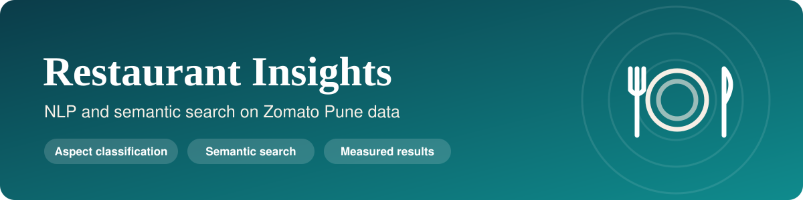
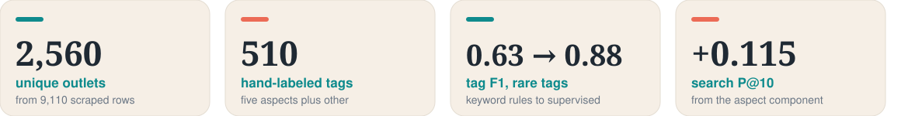
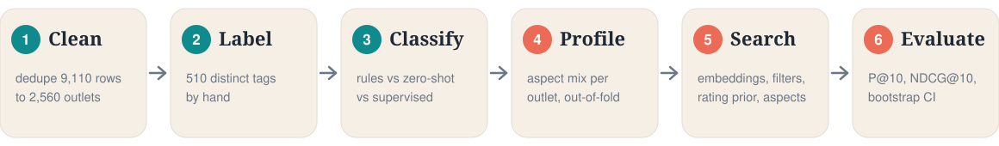
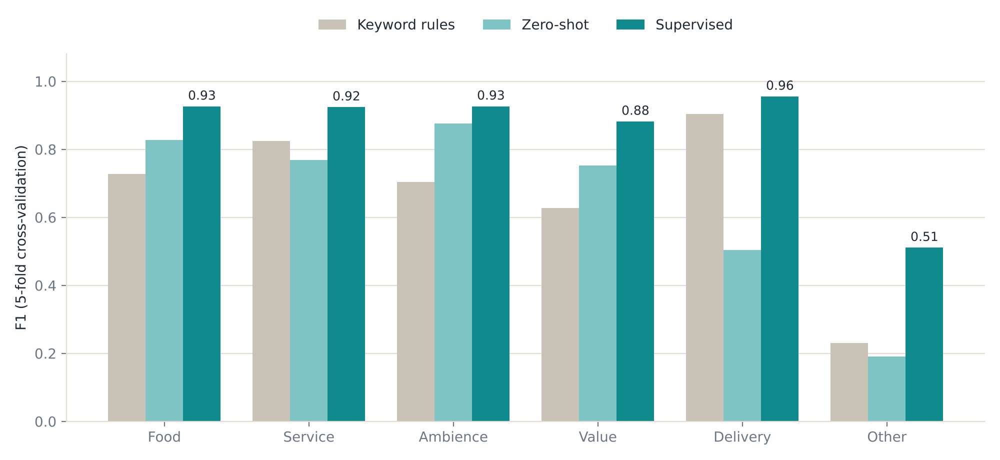
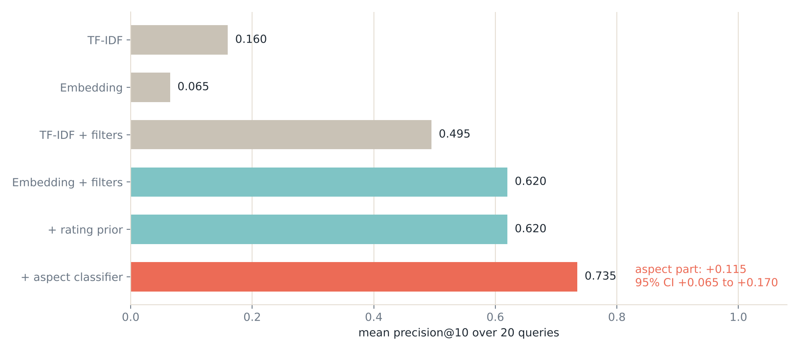
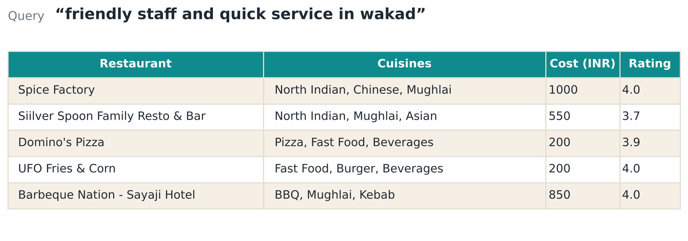
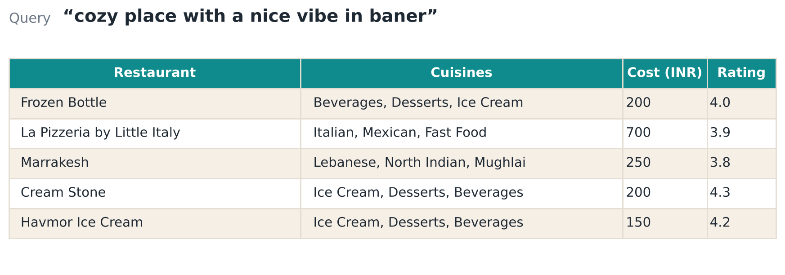

<p align="center">
  
</p>

<p align="center">
  
  
  
  
  
</p>

<p align="center"><b>Which tags are about service, ambience or value, and can a search engine use that to find the right restaurant?</b><br>
A small, honestly evaluated NLP project on scraped Zomato data for Pune.</p>

<p align="center"></p>

---

## 📌 What this project does

Restaurant listings carry short review highlights such as *"timely service"* or *"great portions"*. This project:

1. 🧹 **Cleans** the scraped data. The same outlet appears once per area it delivers to, so 9,110 rows are really **2,560 outlets**.
2. 🏷️ **Classifies** each review tag into an aspect (food, service, ambience, value, delivery, other) and measures how much a trained model beats keyword rules.
3. 🔎 **Searches** restaurants with natural queries like *"friendly staff and quick service in wakad"*, and measures what each part of the search adds.

It extends the original EDA assignment in `main.ipynb`, which is kept unchanged.

<p align="center"></p>

## 📊 Results

### 🏷️ 1. Aspect classification of review tags

Scored against a hand-labeled set covering all 510 distinct tags. The **rare-tag split** trains on the 250 most frequent tags and tests on the 260 rarer ones, so the model must handle phrasing it has not seen. It is the fairer number, because many tags are near-duplicates.

| Method | 5-fold CV micro-F1 | Rare-tag split micro-F1 |
|---|---|---|
| Keyword rules (from `main.ipynb`) | 0.631 | 0.627 |
| Zero-shot embeddings (no training) | 0.755 | 0.730 |
| **Supervised** (char n-gram TF-IDF + embedding, logistic regression) | **0.905** | **0.876** |

<p align="center"></p>

The weakest class is "other" (F1 0.51), which is small (28 tags) and mixed.

### 🔎 2. Semantic restaurant search

Each outlet becomes a text document (cuisines, address, price band, tags). Systems are built from parts, so each part's contribution can be measured:

| Part | What it does |
|---|---|
| **filters** | Hard area, cuisine and cheap or premium filters parsed from the query |
| **rating prior** | A Bayesian-averaged rating, so an outlet with 3 ratings does not beat one with 3,000 |
| **aspect classifier** | The query's aspects (from Task 1) multiplied by each outlet's aspect profile |

20 queries had at least 5 relevant outlets and were scored (of 30 written):

<p align="center"></p>

| System | P@10 | NDCG@10 |
|---|---|---|
| TF-IDF | 0.160 | 0.197 |
| Embedding | 0.065 | 0.070 |
| TF-IDF + filters | 0.495 | 0.531 |
| Embedding + filters | 0.620 | 0.675 |
| Embedding + filters + rating prior | 0.620 | 0.684 |
| **Embedding + filters + prior + aspect classifier** | **0.735** | **0.813** |

The aspect classifier changes P@10 by **+0.115** (95% bootstrap CI +0.065 to +0.170, 20 queries). The gain comes from queries about service, ambience, value, delivery and food. For pure area, cuisine and price queries the filters alone already reach 1.00. Plain TF-IDF or embedding similarity alone does poorly, because one averaged vector per long document cannot hold an area or price constraint.

### 👀 Example output

<p align="center"></p>
<p align="center"></p>

## ⚙️ How it works

1. **Clean and dedupe.** Rows are collapsed by (name, address). When scrapes disagree on a rating, the row with the most votes wins. Vote counts like `3,705` and `11.2K` are parsed, `-`, `New` and zero-vote ratings become missing, and cost is normalized per person.
2. **Label.** Each of the 510 distinct tags gets one or more aspects by hand. The labels were written by reading the tags, not from the keyword rules.
3. **Classify.** Keyword rules, zero-shot embedding similarity and a supervised model are compared with cross-validation and a rare-tag split.
4. **Profile.** Every tag gets an out-of-fold aspect probability (from a model that never saw its label). An outlet's profile is the mean over its tags, which keeps the search evaluation honest.
5. **Search.** Outlet documents are embedded and ranked with the parts above.
6. **Evaluate.** Precision@10 and NDCG@10 over written queries, with a paired bootstrap over queries.

## 🚀 Run it

```bash
pip install -r requirements.txt
python -m spacy download en_core_web_md
jupyter notebook restaurant_nlp_extension.ipynb
```

The notebook is saved already executed, so the results are visible without running it. Setting `EMBED_BACKEND=sbert` switches to sentence-transformers (`all-MiniLM-L6-v2`). That backend is included but was not run, so its numbers will differ. Rebuild the figures with `python make_figures.py`.

Use the search directly:

```python
S = Searcher(outlets, docs, EMB, q33, q67, tag_proba=tag_proba, aspect_model=aspect_model)
S.search("cozy place with a nice vibe in baner", "embedding+filters+prior+aspect", k=5)
```

## 🗂️ Repository layout

```
restaurant_nlp_extension.ipynb   main notebook (executed)
nlp_core.py                      cleaning, dedupe, embeddings, metrics
aspects.py                       rule baseline, zero-shot, supervised aspect model
search.py                        documents, retrieval systems, query parsing, evaluation
labels/aspect_labels_draft.csv   hand labels for the 510 tags
outputs/                         result tables and the judgment template
figures/                         banner, diagrams and charts used above
make_figures.py                  regenerates the README figures
build_notebook.py                regenerates the notebook
main.ipynb, zomato_scraper.py,   original EDA project (unchanged)
  data.csv
```

## ⚠️ Limitations

- **Short tags, not reviews.** There are 510 distinct templated phrases, almost all positive, so this classifies what a tag is about and cannot measure sentiment.
- **Thin text signal.** Zomato shows at most 6 tags per outlet, and 61% of outlets have none, so those outlets are ranked on cuisine, price, address and rating only.
- **One labeler.** The labels are one person's reading with no agreement score, and near-duplicate tags make the cross-validation number optimistic.
- **Synthetic relevance.** Search relevance is derived from structured fields and the same hand labels. The queries were written by one person who had seen the data. The numbers compare systems and do not measure real user satisfaction. `outputs/judgment_template.csv` lets you replace the rule with your own judgments.
- **Static word vectors.** The default backend averages word vectors. A sentence-transformer should handle paraphrases better.
- **No personalization.** There are no users or interactions, so collaborative filtering is not possible with this data.
- **Data source.** The data was collected by scraping Zomato, which its terms of service generally prohibit. This is an academic project, and the data should not be redistributed.

## 🔭 Next steps

- LLM-based aspect extraction with a structured output, compared against the models here
- A faithfulness check on generated restaurant summaries
- Hand-judged search relevance and a sentence-transformer backend
